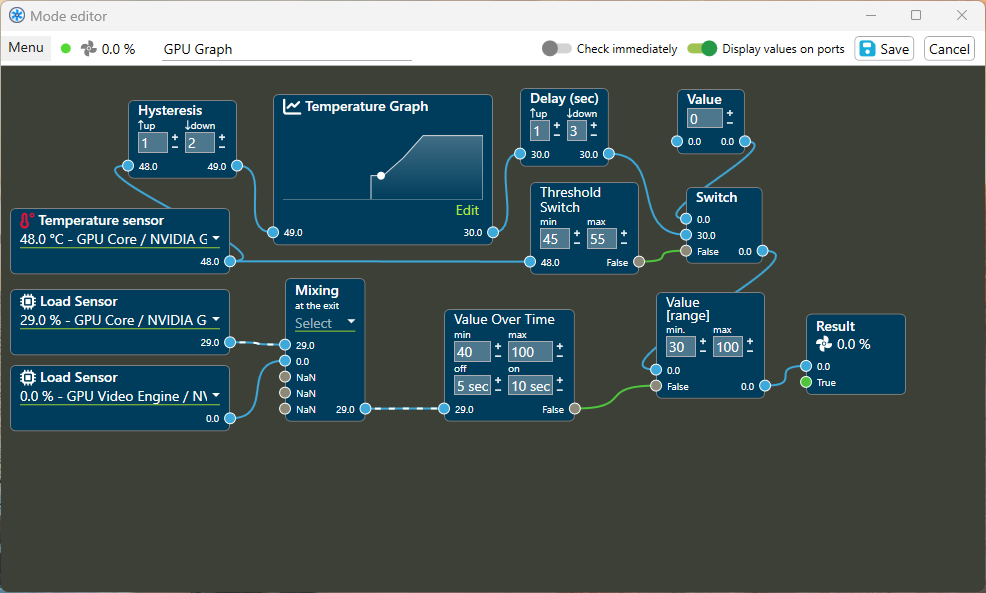
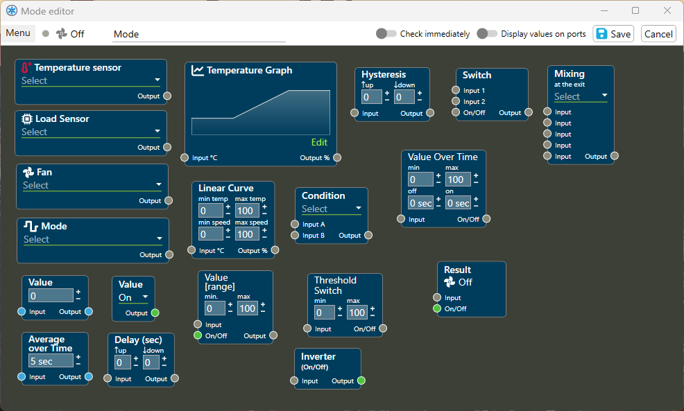
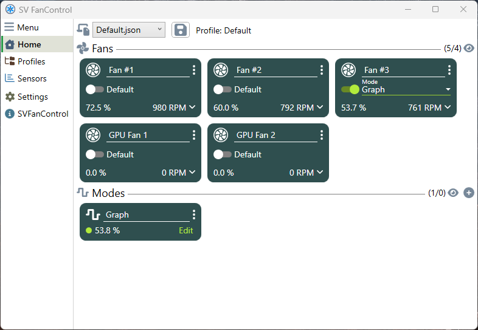
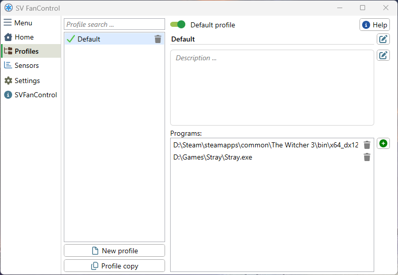
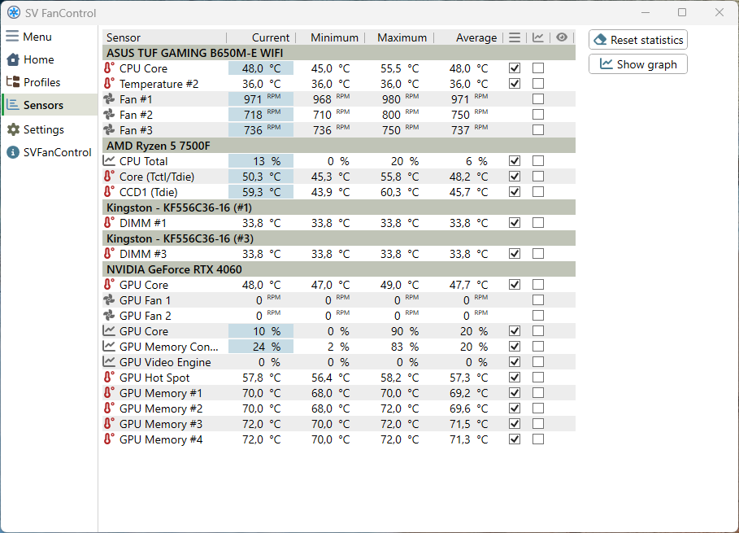

# SVFanControl — Visual Node-Based Fan Curve Editor

A custom fan control application for **Windows 10 and 11**, built with **.NET 10**.

This project was created because existing tools like *FanControl* lacked the flexibility and features I needed. So I wrote my own — with a **visual node editor** for building fan curves exactly the way you want.

## ✨ Features

- **Visual node editor** — design fan curves by connecting nodes instead of editing plain tables
- **Flexible fan modes** — configure different behavior for different fans
- **Built for Windows 10 & 11**
- **Powered by .NET 10**

## 📥 Download

Ready-to-use builds are available in the **[Releases](../../releases)** section.

1. Open the **Releases** page.
2. Download the latest `.zip` / `.7zip` file.
3. Extract (if needed) and run the application.

> No source code required — just download and run.

## 🖥️ Requirements

- Windows 10 or Windows 11
- .NET 10 runtime (if not bundled with the build)
- The program is written in .NET 10, runs only on Windows 10/11, and requires no installation.
- The Lite version is smaller in size, but it requires the .NET 10 Desktop Runtime to be installed.

## 🧩 Why another fan control app?

Tools like FanControl are great, but I needed more flexibility and specific features that weren't available. This app focuses on a **visual, node-based approach** to fan curve configuration — so you can build complex logic without writing config files by hand.

## 📌 Notes

- This repository hosts **release builds** of the application.
- For questions, suggestions, or bug reports, feel free to open an **Issue**.

## Screenshots

